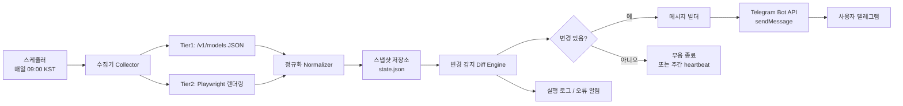

# NVIDIA Build 무료 엔드포인트 감시 → 텔레그램 일일 알림 봇 설계서

- 문서 버전: v1.0 (2026-10-11)
- 대상 독자: VS Code + Kilo Code로 직접 구현할 개발자 1인
- 산출물: 매일 1회 실행되는 Python 앱 + GitHub Actions 스케줄 + 텔레그램 봇 알림
- 구현 언어: Python 3.12 (필요 최소 의존성)

---

## 1. 한 줄 요약

`build.nvidia.com`에서 **무료로 열린 모델이 새로 생기거나, 무료 제공이 끝나기 전("N일 남음" 배너)에** 텔레그램으로 알려주는 감시 봇을 만든다. 데이터는 ① 공식 JSON 모델 목록(안정적) ② 헤드리스 브라우저 렌더링(배너·카운트다운) 두 갈래로 수집하고, 어제 스냅샷과 비교해 **바뀐 것만** 알린다.

**결론: 만들 수 있다.** 다만 "N일 남음" 같은 UI 배너는 자바스크립트로 그려지는 영역이라, 단순 HTTP 요청으로는 안 잡히고 헤드리스 브라우저가 필요하다(아래 §3에서 실측으로 확인).

### 목표
- 무료 엔드포인트의 **신규 등록**을 하루 안에 감지
- 무료 제공 **종료 예고(카운트다운)** 를 놓치지 않고 알림
- 모델 **제거/교체** 감지 (내 Kilo 설정이 갑자기 깨지는 것 방지)
- 사람이 읽는 짧은 한국어 메시지 1건

### 비목표 (명시적 제외)
- 자동으로 Kilo 설정을 수정하는 것 (알림만)
- 실시간(분 단위) 감시 — 일 1회면 충분
- 유료 모델 가격 추적
- NVIDIA 계정/API 키 자동 발급

---

## 2. 배경: 왜 이 앱이 필요한가

NVIDIA Build의 무료 서버리스 API는 **개발·평가용**으로 제공되고, 무료 카탈로그는 예고 없이 바뀐다. 실측 확인 사실:

| 사실 | 값 |
|---|---|
| 무료 티어 한도 | 약 1,000 크레딧(요청 시 최대 5,000), 실사용 약 40 RPM |
| 제공 목적 | 개발·평가용. 프로덕션 수준은 별도 계약 필요 |
| 카탈로그 변동 | 모델 추가/제거가 잦고, 무료 제공 종료 예고가 UI 배너로만 표시됨 |

즉 **"내가 쓰던 무료 모델이 언제 사라지는지"** 를 사람이 매일 사이트에 들어가 확인해야 하는 구조다. 이 반복 노동을 봇이 대신한다.

---

## 3. 데이터 소스 실측 결과 (설계의 근거)

2026-10-11에 실제로 호출해 확인한 내용이다. 설계는 이 사실 위에 세운다.

### 3.1 Tier 1 — 공식 JSON 모델 목록 (권장 주 소스)

```
GET https://integrate.api.nvidia.com/v1/models
```

| 항목 | 실측 결과 |
|---|---|
| HTTP 상태 | `200` |
| 인증 | **불필요** (키 없이 호출 성공) |
| 형식 | `application/json` |
| 크기 | 약 7.6 KB |
| 항목 수 | **80개** |
| 응답 예시 | `{"object":"list","data":[{"id":"01-ai/yi-large","object":"model","created":735790403,"owned_by":"01-ai"}, ...]}` |

**장점**: 안정적, 파싱 쉬움, 키 관리 불필요, CI에서도 그대로 사용 가능.
**한계**: "무료인지"와 "며칠 남았는지"는 이 응답에 없다. 그래서 Tier 2가 필요하다.

### 3.2 Tier 2 — 페이지 렌더링 (배너·카운트다운)

```
GET https://build.nvidia.com/models
```

| 항목 | 실측 결과 |
|---|---|
| HTTP 상태 | `200` (474 KB HTML) |
| `"free"` 문자열 | **0건** |
| `"days left"` / `"deprecat"` / `"sunset"` | **0건** |
| 모델 데이터 | 초기 HTML에 **없음** (클라이언트 렌더링) |

**해석**: 정적 HTML에는 배너 정보가 전혀 없다. 따라서 무료 배지와 "N일 남음" 문구는 **헤드리스 브라우저(Playwright)로 렌더링한 뒤** 텍스트를 추출해야 한다.

### 3.3 시도했지만 사용하지 않은 경로

| 경로 | 결과 | 판단 |
|---|---|---|
| `https://build.nvidia.com/api/models` | `200`이지만 **HTML 반환** | API 아님, 제외 |
| `https://build.nvidia.com/_next/data/build/models.json` | `404` | 제외 |
| `https://api.nvcf.nvidia.com/v2/nvcf/models` | `401` | NGC 키 필요, 제외 |

> **설계 원칙**: 공식 JSON(Tier 1)을 신뢰의 기준으로 삼고, 렌더링(Tier 2)은 "있으면 좋은 정보"로 취급한다. Tier 2가 깨져도 앱 전체가 죽지 않게 만든다.

---

## 4. 아키텍처



### 실행 흐름 (1회 실행)

1. **수집**: Tier 1 JSON + Tier 2 렌더링 결과를 가져온다. 각 소스는 독립적으로 실패 허용.
2. **정규화**: 두 소스를 `모델 ID` 기준으로 병합해 표준 레코드로 만든다.
3. **비교**: `state.json`의 직전 스냅샷과 diff.
4. **분류**: 신규 / 제거 / 무료→유료 전환 / 카운트다운 진입 / 카운트다운 임계(7일 이하) 진입.
5. **알림**: 변경이 있으면 텔레그램 전송, 없으면 로그만 남기고 종료.
6. **저장**: 새 스냅샷을 `state.json`에 커밋(또는 오브젝트 스토리지에 저장).

### 핵심 설계 결정

| 결정 | 이유 |
|---|---|
| 상태를 **파일**로 보관 | 서버 없이 GitHub Actions에서 커밋만으로 상태 유지 가능 |
| Tier 1과 Tier 2를 **분리** | 스크래핑 실패가 전체 감시를 멈추지 않게 |
| 알림은 **변경 시에만** | 매일 같은 메시지가 오면 사람이 무시하게 됨 |
| 카운트다운은 **임계값 기반** | 30일 남음부터 매일 오면 소음. 7일 이하부터 매일 |
| 비밀은 **Telegram 토큰 하나** | NVIDIA 키가 필요 없어 유출면이 작음 |

---

## 5. 데이터 모델

### 5.1 표준 레코드 (정규화 결과)

```json
{
  "id": "moonshotai/kimi-k2-instruct",
  "owner": "moonshotai",
  "name": "Kimi K2 Instruct",
  "first_seen": "2026-09-01",
  "last_seen": "2026-10-11",
  "in_api_list": true,
  "free_badge": true,
  "deadline": "2026-10-25",
  "deadline_source": "banner_text",
  "days_left": 14,
  "notes": ["Free serverless API for development"]
}
```

### 5.2 상태 파일 `state.json`

```json
{
  "schema_version": 1,
  "updated_at": "2026-10-11T09:00:12+09:00",
  "tier1_ok": true,
  "tier2_ok": false,
  "models": { "moonshotai/kimi-k2-instruct": { "...": "위 레코드" } },
  "last_notified": {
    "new": "2026-10-10",
    "countdown": { "moonshotai/kimi-k2-instruct": "2026-10-11" }
  }
}
```

`last_notified`가 중복 알림을 막는 장치다. 같은 모델의 카운트다운을 하루에 두 번 보내지 않는다.

### 5.3 환경변수

| 변수 | 필수 | 설명 |
|---|---|---|
| `TELEGRAM_BOT_TOKEN` | ✅ | BotFather가 발급한 봇 토큰 |
| `TELEGRAM_CHAT_ID` | ✅ | 알림 받을 chat id |
| `NVIDIA_MODELS_URL` | ⭕ | 기본값 `https://integrate.api.nvidia.com/v1/models` |
| `BUILD_MODELS_URL` | ⭕ | 기본값 `https://build.nvidia.com/models` |
| `COUNTDOWN_THRESHOLD_DAYS` | ⭕ | 기본 `7` |
| `DRY_RUN` | ⭕ | `1`이면 전송 대신 로그만 |

**NVIDIA API 키는 필요 없다.** 수집 대상이 모두 공개 엔드포인트이므로 관리할 비밀은 텔레그램 토큰 하나뿐이다.

---

## 6. 변경 감지 규칙

| 이벤트 | 판정 조건 | 알림 |
|---|---|---|
| 신규 무료 모델 | `in_api_list`가 false→true **또는** `free_badge`가 false→true | 즉시 |
| 모델 제거 | 직전 스냅샷에 있고 이번 `in_api_list`가 false | 즉시 (중요도 높음) |
| 무료 종료 예고 | `deadline`이 처음 생김 | 즉시 |
| 카운트다운 진입 | `days_left`가 임계값(기본 7) 이하로 진입 | 매일 1회 |
| 무료→유료 전환 | `free_badge`가 true→false | 즉시 |
| 변화 없음 | 위 어디에도 해당 없음 | 무음 (또는 월요일 heartbeat) |

### 카운트다운 파싱 전략

배너 문구의 정확한 형태는 렌더링 결과를 봐야 확정된다. 그래서 **정규식 휴리스틱 + 실패 시 무해 처리**로 설계한다.

```python
import re
from datetime import date

PATTERNS = [
    r"(\d+)\s*days?\s*left",
    r"(\d+)\s*일\s*남",
    r"expires?\s*in\s*(\d+)\s*days?",
    r"available\s*until\s*([A-Z][a-z]{2}\s+\d{1,2},?\s+\d{4})",
]

def parse_countdown(text: str) -> int | None:
    for p in PATTERNS:
        m = re.search(p, text, re.I)
        if m:
            tok = m.group(1)
            if tok.isdigit():
                return int(tok)
    return None
```

- 문구 패턴이 바뀌면 **파싱 실패 → `days_left = None`** 으로 두고 앱은 계속 돈다.
- 3회 연속 파싱 실패 시 "셀렉터/패턴 재확인 필요" 경고를 관리자에게 1회 전송(자기 감시).

> **구현 시 필수 작업**: 브라우저 개발자도구로 `build.nvidia.com/models`의 모델 카드 DOM을 열어 배지·카운트다운 셀렉터를 확정하고, 위 정규식과 셀렉터를 실제 문구에 맞춘다. 이 문서는 그 **구조와 흐름**을 확정한 것이고, 셀렉터 상수는 구현 시점에 채우는 값이다.

---

## 7. 텔레그램 연동

### 7.1 봇 생성 (1회, 5분)

1. 텔레그램에서 **@BotFather** 검색 → 대화 시작
2. `/newbot` → 봇 표시 이름 입력 → 봇 사용자명 입력 (`...bot`으로 끝나야 함)
3. 발급된 **토큰**(`123456:ABC-DEF...`) 복사 → `TELEGRAM_BOT_TOKEN`
4. **본인이 만든 봇과 먼저 대화를 시작**하고 아무 메시지나 전송 (이걸 안 하면 봇이 먼저 보낼 수 없음)
5. chat id 확인:

```bash
curl -s "https://api.telegram.org/bot${TELEGRAM_BOT_TOKEN}/getUpdates"
# 응답의 result[].message.chat.id 값을 사용
```

6. 전송 테스트:

```bash
curl -s -X POST "https://api.telegram.org/bot${TELEGRAM_BOT_TOKEN}/sendMessage" \
  -d chat_id="${TELEGRAM_CHAT_ID}" \
  --data-urlencode text="테스트: NVIDIA Build 감시 봇 연결 완료"
```

### 7.2 메시지 포맷 (고정)

```
🆕 NVIDIA Build 무료 엔드포인트 변경 (2026-10-11)

[신규] 2건
• moonshotai/kimi-k2-instruct  (무료 배지)
• qwen/qwen3-coder-480b-a35b-instruct

[종료 예고] 1건
• meta/llama-3.3-70b-instruct — 6일 남음 (2026-10-17)

[제거] 1건
• 01-ai/yi-large

총 80개 모델 / 변경 4건 · Tier2 상태: 정상
```

- 상단 1줄에 날짜와 요약
- 섹션은 신규 / 종료 예고 / 제거 / 무료→유료 순
- 4,096자 초과 시 자동 분할 전송
- 이모지는 섹션 구분용으로만 최소 사용

---

## 8. 스케줄링

| 방식 | 장점 | 주의점 | 추천도 |
|---|---|---|---|
| **GitHub Actions cron** | 서버 불필요, 무료, 이력·로그 자동 | **공개 저장소**에서 60일간 저장소 활동이 없으면 예약 워크플로가 자동 비활성화됨. 무료 플랜 **비공개 저장소**는 예약 실행이 제한된다는 보고가 있음 | ★★★ (공개 저장소) |
| Windows 작업 스케줄러 | 로컬, 즉시 동작 | PC가 켜져 있어야 함 | ★★ |
| systemd timer (Linux) | 안정적, 로그 관리 쉬움 | 서버/상시 구동 장비 필요 | ★★ |
| Docker + cron | 이식성 | 관리 부담 | ★ |

### GitHub Actions 60일 규칙 대응

`docs.github.com` 문서 기준: 공개 저장소에서 **60일간 저장소 활동이 없으면 예약 워크플로가 자동 비활성화**된다. 대응책:

- 상태 파일(`state.json`)을 매 실행 후 **커밋**하도록 만들면, 스냅샷이 바뀔 때마다 커밋이 발생해 활동이 유지된다. 변화가 없는 날에도 `last_seen`이 갱신되므로 사실상 항상 커밋된다.
- 별도로 30일마다 "감시 살아있음" heartbeat 알림을 보내 스케줄이 죽었는지 사람이 인지하게 한다.
- 비공개 저장소를 쓸 경우 예약 실행 제한 여부를 먼저 확인하고, 제한이 있으면 Windows 작업 스케줄러로 전환한다.

### 워크플로 초안

```yaml
# .github/workflows/watch.yml
name: nvidia-build-watch
on:
  schedule:
    - cron: "0 0 * * *"   # 00:00 UTC = 09:00 KST
  workflow_dispatch: {}
permissions:
  contents: write
jobs:
  run:
    runs-on: ubuntu-latest
    steps:
      - uses: actions/checkout@v4
      - uses: actions/setup-python@v5
        with:
          python-version: "3.12"
      - run: pip install -r requirements.txt
      - run: python -m src.main
        env:
          TELEGRAM_BOT_TOKEN: ${{ secrets.TELEGRAM_BOT_TOKEN }}
          TELEGRAM_CHAT_ID: ${{ secrets.TELEGRAM_CHAT_ID }}
      - run: |
          git config user.name  "watch-bot"
          git config user.email "watch-bot@users.noreply.github.com"
          git add data/state.json
          git diff --quiet --cached || git commit -m "chore: snapshot $(date -u +%F)"
          git push
```

> Playwright를 CI에서 쓰려면 `playwright install --with-deps chromium` 단계가 추가로 필요하다(약 1~2분 소요). Tier 2를 CI에서 끄고 싶으면 `ENABLE_TIER2=0`으로 실행해 Tier 1만 돌려도 앱은 정상 동작한다.

---

## 9. 프로젝트 구조

```
nvidia-build-watch/
├─ .github/workflows/watch.yml
├─ .env.example                 # TELEGRAM_* 항목만 (실제 토큰은 절대 커밋 금지)
├─ .gitignore                   # .env, data/*.local.json
├─ README.md                    # 실행법
├─ requirements.txt             # httpx, playwright, pytest
├─ pyproject.toml               # ruff / pytest 설정
├─ data/
│  └─ state.json                # 스냅샷 (커밋 대상)
├─ src/
│  ├─ main.py                   # 오케스트레이션 (수집→비교→알림→저장)
│  ├─ config.py                 # 환경변수 로딩·검증
│  ├─ collectors/
│  │  ├─ tier1_api.py           # /v1/models JSON 수집
│  │  └─ tier2_render.py        # Playwright 렌더링·배너 추출
│  ├─ normalize.py              # 두 소스 병합 → 표준 레코드
│  ├─ diff.py                   # 변경 감지 규칙
│  ├─ message.py                # 텔레그램 메시지 빌더
│  ├─ notify.py                 # Telegram Bot API 클라이언트
│  └─ store.py                  # state.json 읽기/쓰기
└─ tests/
   ├─ fixtures/
   │  ├─ models_api_sample.json
   │  └─ rendered_cards_sample.html
   ├─ test_diff.py              # 신규/제거/카운트다운 케이스
   ├─ test_normalize.py
   └─ test_message.py           # 스냅샷 테스트
```

### 기술 스택

| 영역 | 선택 | 이유 |
|---|---|---|
| 언어 | Python 3.12 | 표준 라이브러리 + 짧은 코드, 연구 업무와 동일 언어 |
| HTTP | `httpx` | 타임아웃·재시도 명시적 제어 |
| 렌더링 | `playwright` (chromium) | JS 렌더링 필수(§3.2 실측 근거) |
| 알림 | 표준 라이브러리 `urllib` 또는 `httpx` | SDK 불필요, 의존성 최소화 |
| 테스트 | `pytest` + 저장된 픽스처 | 네트워크 없이 diff 로직 검증 |
| 린트 | `ruff` | 설정 1줄 |

**의존성 3개**(httpx, playwright, pytest)로 끝난다. 프레임워크를 넣지 않는 이유는 실행 시간이 하루 1회, 수 초이기 때문이다.

### 구현 시 지킬 원칙

1. **수집기와 판정 로직 분리** — 테스트가 네트워크에 의존하지 않게.
2. **모든 외부 호출에 타임아웃** — 20초. 무한 대기 금지.
3. **부분 실패 허용** — Tier 2 실패 시 Tier 1 결과만으로 알림, 상태에 `tier2_ok: false` 기록.
4. **재시도는 2회, 지수 백오프** — 429/5xx에만.
5. **`DRY_RUN` 모드 기본 제공** — 토큰 없이 메시지 문자열만 확인.

---

## 10. VS Code에서 시작하기

### 10.1 초기 셋업

```bash
mkdir nvidia-build-watch && cd nvidia-build-watch
git init
python -m venv .venv
# Windows: .venv\Scripts\activate
source .venv/bin/activate
pip install httpx playwright pytest ruff
playwright install chromium
```

### 10.2 Kilo Code에 그대로 던질 프롬프트 (단계별)

> **1단계**: "`src/collectors/tier1_api.py`를 만들어줘. `https://integrate.api.nvidia.com/v1/models`를 httpx로 GET하고, 타임아웃 20초, 2회 재시도(지수 백오프), 응답의 `data[].id`를 `{id, owner, in_api_list}` 형태로 반환해. 네트워크 오류는 예외를 던지지 말고 결과 객체에 오류를 담아 반환해."

> **2단계**: "`src/normalize.py`를 만들어줘. Tier1 결과와 Tier2 결과를 모델 ID 기준으로 병합하고, `data/state.json` 스키마(schema_version, updated_at, tier1_ok, tier2_ok, models, last_notified)로 직렬화해줘. `first_seen`은 기존 상태에 있으면 유지, 없으면 오늘 날짜."

> **3단계**: "`src/diff.py`에 §6 표의 5가지 이벤트를 구현해줘. 입력은 (이전 상태, 새 상태), 출력은 이벤트 리스트. `last_notified`로 중복 알림을 막아줘. 케이스별 pytest를 `tests/test_diff.py`에 작성하고, 픽스처는 `tests/fixtures/`의 JSON을 써서 네트워크 없이 돌아가게 해줘."

> **4단계**: "`src/notify.py`에 Telegram sendMessage 클라이언트를 만들어줘. 4096자 초과 시 분할 전송, 429 응답 시 `retry_after`만큼 대기 후 재시도. `DRY_RUN=1`이면 전송 대신 표준출력에 출력."

> **5단계**: "`src/collectors/tier2_render.py`에 Playwright로 `build.nvidia.com/models`를 렌더링해 모델 카드 텍스트를 추출하는 코드를 작성해줘. 셀렉터는 상수로 분리하고 TODO 주석을 달아줘 — 내가 개발자도구로 확정해서 채울 예정이야. 실패하면 예외 대신 `{'ok': False, 'error': ...}`를 반환하게 해줘."

### 10.3 개발 루프 (테스트 주도)

```bash
# 1) 픽스처 기반 로직 검증 (네트워크 불필요)
pytest -q

# 2) 실제 수집만 확인 (알림 없음)
DRY_RUN=1 python -m src.main --collect-only

# 3) 메시지 미리보기
DRY_RUN=1 python -m src.main --force-notify

# 4) 실제 전송
python -m src.main
```

`--force-notify`(변경이 없어도 메시지 생성) 옵션을 꼭 넣는다. 메시지 포맷을 반복 개선할 때 유용하다.

---

## 11. 마일스톤

| 단계 | 내용 | 완료 기준 |
|---|---|---|
| **M1** | Tier 1 수집 + 상태 저장 | `state.json`에 80개 모델 레코드 생성 |
| **M2** | diff 엔진 + 테스트 | 픽스처 기반 신규/제거/카운트다운 케이스 전부 통과 |
| **M3** | 텔레그램 전송 | `DRY_RUN` 미리보기 → 실제 봇으로 테스트 메시지 수신 |
| **M4** | 스케줄러 연결 | GitHub Actions 수동 실행 1회 성공, 상태 커밋 확인 |
| **M5** | Tier 2 렌더링 + 카운트다운 | 개발자도구로 셀렉터 확정 후 "N일 남음" 파싱 성공 |
| **M6** | 운영 안정화 | heartbeat 알림, 파싱 실패 자기감시, README 정리 |

**M1~M4만 끝나도 실사용 가치가 있다.** Tier 2(M5)는 배너가 자주 바뀌는 영역이라 마지막에 붙이는 게 순서상 옳다.

---

## 12. 리스크와 완화

| 리스크 | 영향 | 완화 |
|---|---|---|
| 사이트 DOM/문구 변경 | 카운트다운 파싱 실패 | 정규식 휴리스틱 + 실패 시 무해 처리 + 3회 연속 실패 시 경고 |
| 봇 차단(403/Cloudflare) | 수집 실패 | Tier 1은 순수 JSON이라 영향 없음. Tier 2는 `render_js` 계열 헤드리스로 우회, 실패 시 건너뜀 |
| `/v1/models` 스펙 변경 | 전체 중단 | 응답 구조 검증 + 스키마 불일치 시 알림(조용한 실패 금지) |
| GitHub Actions 예약 비활성 | 감시 중단 | 상태 커밋으로 활동 유지 + heartbeat 미수신 감지 |
| 텔레그램 429 | 알림 유실 | `retry_after` 준수, 하루 1건 수준이라 실제 위험 낮음 |
| 토큰 유출 | 봇 탈취 | 토큰은 저장소 시크릿/환경변수만. 커밋 전 `git diff` 확인, `.env`는 `.gitignore` |
| 알림 피로 | 무시하게 됨 | 변경 시에만 전송, 카운트다운은 임계 이하만, 무음 기본 |

### 법적·윤리 체크

- 공식 공개 JSON(Tier 1)을 **주 소스**로 사용하고, 렌더링(Tier 2)은 공개 페이지를 개인 용도로 읽는 수준으로 제한한다.
- 요청 간격을 하루 1회로 두고, 병렬 요청·과도한 폴링을 하지 않는다.
- `robots.txt`와 이용약관을 구현 전에 확인하고, 차단 의사가 명확하면 Tier 2를 끄고 Tier 1만 쓴다.

---

## 13. 운영 비용

| 항목 | 비용 |
|---|---|
| GitHub Actions (공개 저장소) | 0원 |
| 텔레그램 봇 | 0원 |
| NVIDIA 엔드포인트 호출 | 0원 (공개 JSON) |
| 실행 시간 | 1일 1회, 수 초~2분 (Tier 2 포함) |

---

## 14. 부록

### A. 최소 동작 스니펫 (Tier 1 수집)

```python
import httpx

def fetch_models(url: str = "https://integrate.api.nvidia.com/v1/models"):
    try:
        r = httpx.get(url, timeout=20.0)
        r.raise_for_status()
        data = r.json()
        return {
            "ok": True,
            "models": {
                m["id"]: {"id": m["id"], "owner": m.get("owned_by", ""), "in_api_list": True}
                for m in data.get("data", [])
                if m.get("id")
            },
        }
    except Exception as e:                      # 부분 실패 허용
        return {"ok": False, "error": f"{type(e).__name__}: {e}", "models": {}}
```

### B. 텔레그램 전송 스니펫

```python
import httpx, os, time

def send(text: str):
    token, chat = os.environ["TELEGRAM_BOT_TOKEN"], os.environ["TELEGRAM_CHAT_ID"]
    url = f"https://api.telegram.org/bot{token}/sendMessage"
    for chunk in [text[i:i+4000] for i in range(0, len(text), 4000)] or [""]:
        if os.getenv("DRY_RUN") == "1":
            print(chunk); continue
        for attempt in range(3):
            r = httpx.post(url, data={"chat_id": chat, "text": chunk}, timeout=20.0)
            if r.status_code == 429:
                time.sleep(int(r.json().get("parameters", {}).get("retry_after", 5)))
                continue
            r.raise_for_status()
            break
```

### C. 검증 체크리스트 (배포 전)

- [ ] `DRY_RUN=1 python -m src.main` 이 네트워크만 쓰고 정상 종료
- [ ] `pytest -q` 전부 통과 (네트워크 없이)
- [ ] 실제 봇으로 테스트 메시지 수신 확인
- [ ] `state.json` 커밋이 워크플로에서 실제로 push 되는지 확인
- [ ] `.env` / 토큰이 저장소에 없는지 `git log -p` 로 확인
- [ ] 카운트다운 파싱 실패 시에도 앱이 죽지 않는지 강제로 픽스처를 깨서 확인

### D. 이 문서에서 확정하지 않은 것 (구현 시 채울 값)

1. **모델 카드 DOM 셀렉터** — `build.nvidia.com/models`를 브라우저로 열고 개발자도구에서 확정.
2. **"N일 남음" 배너의 실제 문구** — 정규식 패턴을 실제 문자열에 맞춰 조정.
3. **무료 배지의 정확한 표기** — `Free` / `무료` 등 실제 라벨 확인 후 `free_badge` 판정 규칙 확정.

이 세 가지는 사이트가 바뀌면 함께 바뀌는 값이라, 코드에서는 상수로 분리하고 이 문서의 §6 파싱 전략(실패해도 계속 동작)을 그대로 유지하는 것이 핵심이다.
